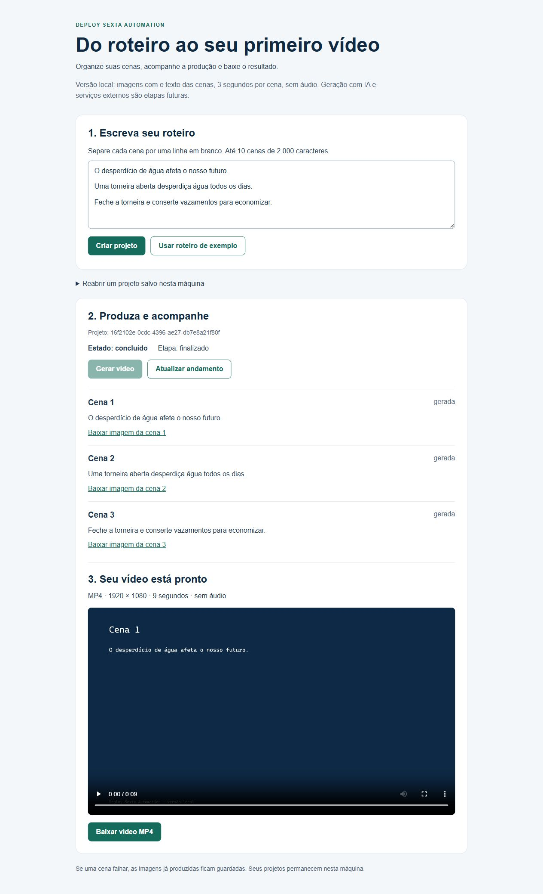

# Verificação local da feature 001

Data: 10/10/2026. Ambiente: Windows, Node 22.16.0. Agente: Codex. Fonte inicial: commit `a02bfe669ec058e510f0bae006dbd9a9f0340a15`, com implementação local ainda sem commit nesta sessão.

## Provas executadas

- Suíte automatizada: **4 suítes, 21 testes passando**. Critérios CA-01 a CA-07, limites de entrada, timeout de montagem, reexecução, interface e mídia real.
- Integração de vídeo: imagens PNG 1920 x 1080 e MP4 H.264 de três cenas com 9 segundos. O teste decodifica o MP4 e compara quadros de 1, 4 e 7 segundos com as imagens correspondentes; tolerância de erro considera a compressão do vídeo.
- Integração de preservação: falha controlada na terceira cena, reexecução e comparação SHA-256 das duas imagens anteriores.
- `npm run lint`: executado sem erros.
- Comando portátil `node scripts/post-edit.mjs`: executou ESLint com saída 0. Execução direta; ainda falta provar o disparo pelo Claude Code após edição.
- `npm run build`: passou com webpack e verificação TypeScript, sem download de fontes remotas.
- `node scripts/verify-api.mjs`: passou. HTTP 200 na página; criação de três cenas pendentes; recusa de vazio, 11 cenas e 2001 caracteres; bloqueio HTTP 409 de execução concorrente; geração concluída; download MP4 válido e PNG; acesso a project.json recusado; recuperação após reinício; projeto concluído não reprocessado.
- Navegador: roteiro de exemplo criado pelo formulário, três cenas inicialmente pendentes, botão Gerar vídeo, resultado concluído, três links de imagens e MP4 com duração de 9 segundos visível no player.

## Mapa dos sensores

| Critério | Teste |
|---|---|
| CA-01 | project.test.ts e workflow.test.tsx: criação, ordem e pendentes |
| CA-02 | project.test.ts, local-media.test.ts e script HTTP: conclusão, mídia real e download |
| CA-03 | project.test.ts, workflow.test.tsx e local-media.test.ts: falha, erro e preservação |
| CA-04 | Mesmos três arquivos: reexecutar só o que falhou e conservar os arquivos |
| CA-05 | project.test.ts e workflow.test.tsx; recusa real na API |
| CA-06 | project.test.ts; recusa real na API |
| CA-07 | project.test.ts: exatamente dez minutos com relógio controlado e cancelamento |

## O que esta verificação não prova

Não substitui clone por outro integrante, revisão humana dos critérios, validação da proposta pelo professor nem as provas de skill/deny/hook do Claude Code. Não afirma integração externa ou geração por IA. Os relatórios históricos do Better Harness foram preservados; não foi criada uma nova medição fictícia.

## Revisão em cópia limpa (10/10/2026)

O Codex extraiu o pacote numa pasta nova `validacao-limpa-revisao/n2persistencia`, fora do checkout principal. Executou `npm ci`, testes (21 passaram), lint, build e prova HTTP. A prova HTTP gerou MP4 real de três cenas (84.383 bytes), recusou execução concorrente e confirmou persistência após reinício. Projeto da prova: `15bf6056-e1b3-445a-8a08-e6f1def7cc14`.

Código, scripts, testes e configurações do pacote foram comparados com a cópia testada. É pré-verificação do agente por extração limpa, **não clone por outro integrante**.

A instalação informou 24 avisos de vulnerabilidade nas dependências de desenvolvimento (19 moderados, 5 altos). `npm audit --omit=dev --json` retornou zero vulnerabilidades nas dependências de execução nessa consulta. Isso não equivale a auditoria completa de segurança; não foi aplicada atualização forçada que poderia alterar a stack da entrega.
